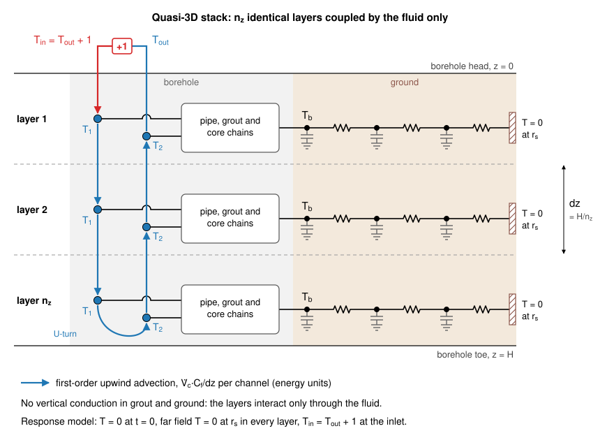

# ThermalResistanceCapacitanceModel.jl

*Quasi-3D thermal resistance and capacity models (TRCM) of ground heat exchangers, in pure Julia.*

`ThermalResistanceCapacitanceModel.jl` computes the **outlet transfer function** of a ground heat
exchanger: the outlet fluid temperature in response to a constant heat injection, from seconds to
decades. The TRCM accounts for the transit of the fluid, the thermal capacity of the fluid, the
pipes and the grout, and the thermal short-circuit between the down-going and up-going fluid along
the depth.

It is the borehole layer of the GHE.jl ecosystem:
[`BoreholeResistance.jl`](https://github.com/GHE-jl/BoreholeResistance.jl) gives the steady-state
resistances that every cross-section of the TRCM reproduces exactly, and
[`GroundHeatExchanger.jl`](https://github.com/GHE-jl/GroundHeatExchanger.jl) joins the TRCM to the
long-term ground models to build the g-functions and transfer functions used for simulation and
design.



## Exchangers

| Type | Cross-section | Steady-state inputs |
|---|---|---|
| [`SingleUTube`](@ref) | 2 pipes in grout | multipole `Rb`, `Ra` (Javed & Spitler, 2017) |
| [`DoubleUTube`](@ref) | 4 pipes in grout, diagonal or adjacent inlets | multipole `Rb`, `Rdₐ`, `Rₐₐ` (Claesson & Javed, 2019) |
| [`Coaxial`](@ref) | center pipe, annulus, optional grout | `R12`, `R1` (Lamarche, 2021; Bauer et al., 2011) |
| [`StandingColumn`](@ref) | dip tube, open annulus in contact with the rock | films and dip tube (Nguyen et al., 2015) |

Every exchanger can receive a steel [`Casing`](@ref) over the top of the borehole (without vertical
conduction only).

## Which function?

| Call | Model | Time range | Cost |
|---|---|---|---|
| [`trcm`](@ref)`(t, ex, ks, Cs, H, V̇, fluid)` | layers coupled by the fluid only, no vertical conduction in the ground | seconds to months | ~0.1 s |
| [`trcm`](@ref)`(...; D)` | with vertical conduction in the ground (buried depth `D`) | seconds to decades | 1.5–3 s |
| [`trcm_pairs`](@ref)`(t, ex, ks, Cs, H, D, V̇, fluid, d)` | single-borehole and borehole-to-borehole responses at the distances `d` (Rose et al., 2026) | seconds to decades | 4–7 s for 5 distances |
| `outlet_transfer_function(t, ex, ks, Cs, H, D, V̇, fluid)` | TRCM up to 7 days, then a long-term ground model (finite line source by default), any borefield | seconds to decades | ~0.1 s |
| `outlet_transfer_function(...; long = :trcm)` | `trcm(...; D)`, or for a borefield of single U-tubes the BC-IV response built from `trcm_pairs` | seconds to decades | 1.5–3 s, ~13 s for a 5×5 field |

Single U-tube of 150 m, warm timings (indicative). `outlet_transfer_function` is a method of
GroundHeatExchanger.jl, available after `using GroundHeatExchanger, ThermalResistanceCapacitanceModel`.
The precision of each option is compared in
[With or without vertical conduction](@ref) and [Borefield (BC-IV) g-function](@ref).

## Installation

The package is not registered yet. From the `GHE.jl` folder:

```julia
using Pkg
Pkg.develop(path = "ThermalResistanceCapacitanceModel.jl")
```

## Quick example

```julia
using ThermalResistanceCapacitanceModel

ex = SingleUTube(0.075, 0.0167, 0.0137, 0.06, 1.5, 2.0e6, 0.4, 1.8e6)   # rb, ro, ri, s, kg, Cg, kp, Cp
fluid = FluidProperties(10.0, :water)                                     # water at 10 °C
t = exp10.(range(0, 7; length = 150))                                     # 1 s to ~4 months
g = trcm(t, ex, 2.5, 2.2e6, 150.0, 0.5e-3, fluid)                         # ks, Cs, H, V̇
```

`g` is the outlet temperature for `Tin − Tout = 1`, i.e. for a constant heat injection rate.

## Where to go next

- [Tutorial](@ref): every function, step by step, and the scripts that reproduce the figures.
- Modeling theory: the [Cross-section networks](@ref), the [Response model](@ref), the junction
  with long-term ground models ([Short and long term](@ref)) and the
  [Borehole-to-borehole responses](@ref).
- [Design notes](@ref): what differs from the research code the package comes from.
- [API reference](@ref) and [References](references.md).
