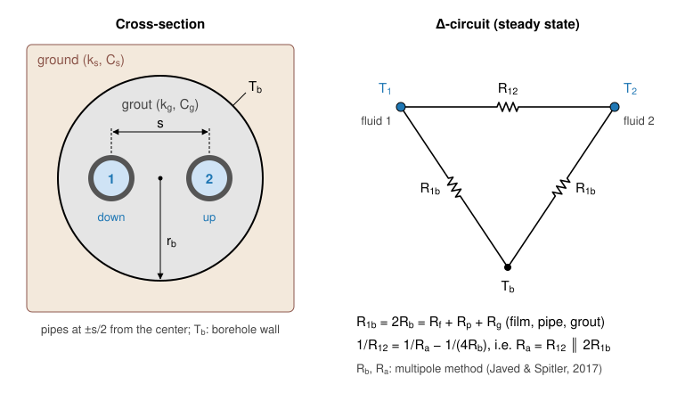
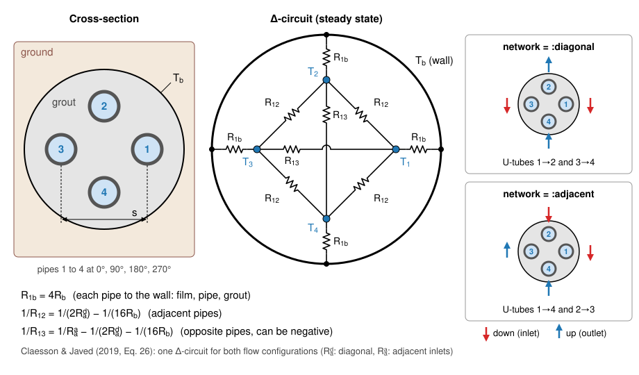
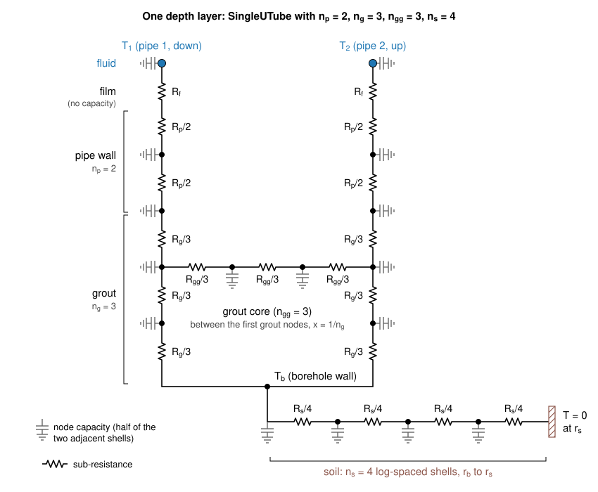
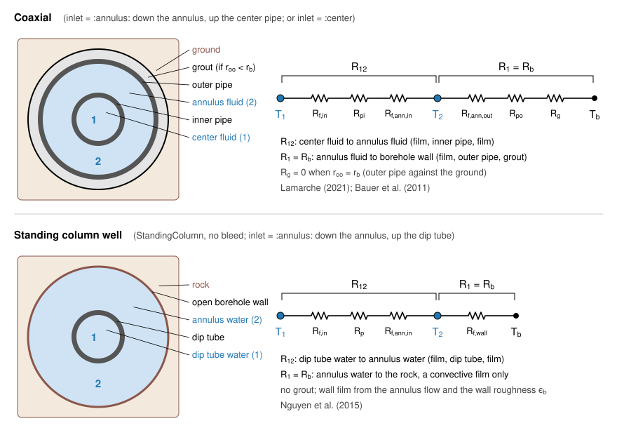

# Cross-section networks

Each depth layer of the model is a network of thermal resistances and capacities per unit length of
borehole. The governing equation at every free node ``j`` is (Nguyen et al., 2015, Eq. 3)

```math
C_j \frac{dT_j}{dt} = \sum_{k \in \mathcal{N}(j)} \frac{T_k - T_j}{R_{jk}},
```

i.e. ``C\,\dot T = A\,T`` with ``A`` a symmetric, weighted graph Laplacian (grounded at the far
field).

## Sub-resistances and capacities

Following Pasquier & Marcotte (2012), each material layer of resistance ``R`` between two radii is
split into ``n`` sub-resistances ``R/n``. For a uniform conductivity, equal sub-resistances
correspond to log-spaced radii ``r_{j+1} = r_j\,(r_\text{out}/r_\text{in})^{1/n}`` (their Eq. 9),
and each node receives half of the area of its two neighbouring shells (their Eq. 8). Convective
films are capacity-free resistances added in series to the first or last sub-resistance. The total
capacity of a layer equals the capacity of its materials exactly (tested), except the half shell
adjacent to the fixed far field.

## The steady-state constraint

Whatever its topology, a TRCM must reduce to the steady-state resistances of the borehole (Bauer et
al., 2011): the borehole resistance ``R_b`` (all fluids at the same temperature) and the internal
resistance ``R_a`` (thermal short-circuit between the legs). They are computed
with `BoreholeResistance.jl` ([`delta_circuit`](@ref ThermalResistanceCapacitanceModel.delta_circuit)),
including the convective films for the actual flow rate.

## U-tubes





For ``n`` symmetric pipes, the Δ-circuit has a pipe-to-wall resistance ``R_{1b} = n R_b`` and
pipe-to-pipe resistances: ``1/R_{12} = 1/R_a - 1/(4R_b)`` for a single U-tube, and, for a double
U-tube (Claesson & Javed, 2019, Eq. 26),

```math
\frac{1}{R_{12}} = \frac{1}{2R^d_a} - \frac{1}{16R_b}, \qquad
\frac{1}{R_{13}} = \frac{1}{R^a_a} - \frac{1}{2R^d_a} - \frac{1}{16R_b}.
```

Each pipe is linked to the borehole wall by its film ``R_f``, its wall ``R_p`` (``n_p``
sub-resistances) and the grout ``R_g = R_{1b} - R_f - R_p`` (``n_g`` sub-resistances). The grout
"core" chains (``n_{gg}`` sub-resistances) link the first grout node of every pair of pipes, i.e.
they start at the fraction ``x = 1/n_g`` of ``R_g`` (``x = 0`` for ``n_g = 1``). Writing
``a = R_f + R_p + xR_g`` and ``b = (1-x)R_g``, eliminating the grout nodes gives the conductance
matrix seen from the fluids, ``S = I/a - K^{-1}/a^2`` with ``K = (1/a + 1/b)I + L(G^{gg})``.
Imposing ``S`` equal to the Δ-circuit gives the core conductances directly:

```math
G^{gg} = -\left[\left(aI - a^2 S_\Delta\right)^{-1} - \left(\frac{1}{a} + \frac{1}{b}\right) I\right].
```

For two pipes this is Eq. 21 of Bauer et al. (2011) (Eq. 10 of Pasquier & Marcotte, 2012) at the
location ``x``; the same expression covers the double U-tube. The network then reproduces ``R_b``
and ``R_a`` (``R^d_a``, ``R^a_a``) to machine precision for any ``n_g`` (tested).



The grout area is split as in `gTRCM.m`: a core area between the pipe centers (``2r_o s - \pi r_o^2``
for two pipes, the square between the four pipe centers minus four pipe quarters for four pipes)
shared by the core chains, and the remaining annulus between an equivalent radius ``r_g^*`` and
``r_b`` shared by the outer grout chains (Pasquier & Marcotte, 2014, Eq. 11).

### Negative resistances

The Δ-circuit can contain negative resistances, e.g. ``R_{13}`` of a double U-tube or ``R_{gg}``
when the pipes are close to the borehole wall (Bauer et al., 2011, Section 2.6). A negative
resistance is a valid steady-state (algebraic) equivalence, but a node reached only through
negative sub-resistances is unconditionally unstable. Negative core chains are therefore never
subdivided, and every distinct layer is checked for stability: the layer is stable if and only if
``-A`` is positive definite (a Cholesky factorization). If not, Bauer et al. recommend moving the
grout capacity closer to the pipes, i.e. increasing ``n_g`` or using ``n_g = 1``.

For four symmetric pipes there is a single Δ-circuit (``R_{1b}``, ``R_{12}``, ``R_{13}``; Claesson &
Javed, 2019, Eq. 26), shared by the diagonal and adjacent flow configurations. Its opposite-pipe
resistance ``R_{13}`` is often negative; the zeroth-order line-source matrix (Hellström; Lamarche,
2023, Eqs. 5.42-5.46) gives the same sign, so it is not a numerical artefact. With diagonal inlets
the two opposite pipes carry the same fluid and ``R_{13}`` is inactive. With adjacent inlets it
links a down-going and an up-going pipe, and the outlet undershoots very slightly before the fluid
residence time: the layer remains stable, and the undershoot is the non-physical side of an
equivalent steady-state circuit used in a transient model (Bauer et al., 2011, Section 2.6). The
responses returned by [`trcm`](@ref) are therefore set to 0 wherever they would be negative.

## Coaxial exchangers



The coaxial cross-section is axisymmetric (Bauer et al., 2011, Fig. 2): center fluid → film →
inner pipe → film → annulus fluid → film → outer pipe → grout → borehole wall. The resistances are
those of `BoreholeResistance.resistance_coaxial` (Lamarche, 2021): ``R_{12}`` between the two fluids
and ``R_1 = R_b`` between the annulus and the wall. Without grout (``r_{oo} = r_b``) the outer pipe
is in direct contact with the ground.

## Standing column wells

The standing column well (Nguyen et al., 2015) is an open borehole: dip tube water → film → dip
tube → film → annulus water → wall film → rock. The annulus film coefficient uses the annulus
Nusselt number of Lamarche (2021) with the roughness of the dip tube and of the borehole wall. The
groundwater flow induced by a bleed (their advective aquifer resistance) is not modeled.

## Ground

Every layer ends with an optional ring between ``r_b`` and ``r_b + e`` (casing material in the cased
layers, ground below the casing, so that the soil nodes have the same radii in every layer) and
``n_s`` log-spaced soil shells out to the far-field radius ``r_s``, held at the initial temperature.
