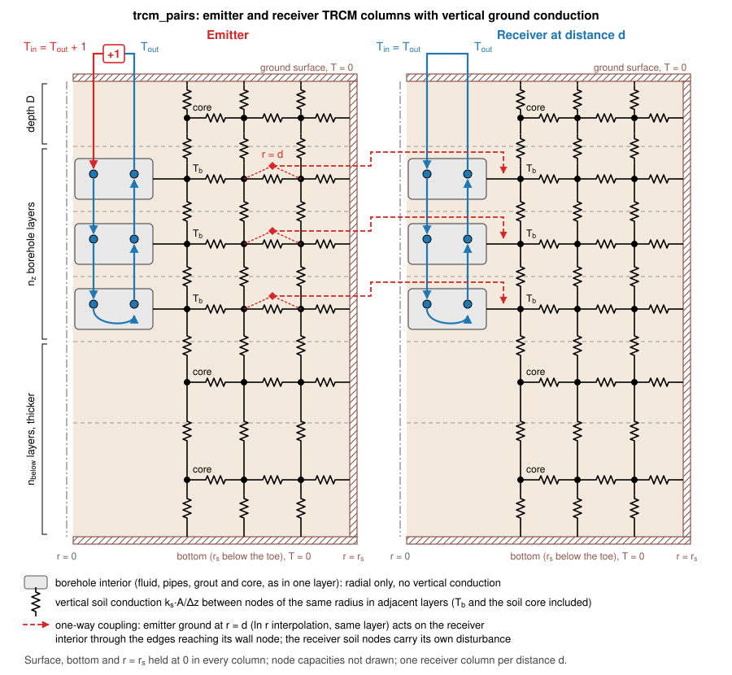

# Borehole-to-borehole responses

Rose et al. (2026) build BC-IV g-functions (same inlet temperature and flow rate in every
borehole) from **pairs of complete boreholes** simulated in a 3D finite element model. The emitter
operates under the response-model condition ``T_\text{in} = T_\text{out} + 1``, the receiver in
recirculation (``T_\text{in} = T_\text{out}``). The emitter outlet gives the single-borehole response
function, the receiver outlet the borehole-to-borehole response function at that distance; the
block matrix algorithm of Dusseault et al. (2018) then combines them for any borefield. Because the
emitter is a complete borehole, its heat flux builds up progressively (borehole capacities, fluid
residence time) and varies along its length, two effects that the finite line source (FLS)
neglects. In their homogeneous scenario the FLS overestimates the borehole-to-borehole responses by
up to 4.5 % at 6 m.

[`trcm_pairs`](@ref) reproduces this configuration with TRCM columns (single U-tube for now)
and returns the emitter outlet `g_self`, i.e. [`trcm`](@ref) with a buried depth `D`, and the
receiver outlets `g_pair`. `outlet_transfer_function` of GroundHeatExchanger.jl (`long = :trcm`,
see [Short and long term](@ref)) combines them into the BC-IV g-function of a borefield.

## Network

- **Columns.** The emitter and every receiver are stacks of TRCM layers with the same radial soil
  nodes, the columns of [`trcm`](@ref) with a buried depth `D` (see
  [Vertical conduction in the ground](@ref)): the ground conducts heat vertically (between soil
  nodes of the same radius, conductance ``k_s A_i / \Delta z``), and every column has soil layers
  over the buried depth ``D`` and below the borehole toe (``n_\text{below}`` layers, geometrically
  thicker, down to a depth ``r_s`` below the toe). The ground surface, the bottom of the domain and
  the far-field radius ``r_s`` are held at 0. The vertical conduction inside the borehole (fluid,
  pipes, grout) is neglected, as in the rest of the package.
- **One-way coupling.** A receiver sees the ground temperature of the emitter at its location
  (interpolated in ``\ln r`` between the soil nodes of each layer). Its interior nodes (fluid, pipes,
  grout) carry their actual temperature, and its soil nodes the disturbance the receiver adds to
  the field of the emitter; the two meet at the borehole wall. The effect of a receiver on the
  emitter is neglected (second order). The system is therefore block lower triangular, and all the
  distances are solved at once: the KLU sparse LU detects the block structure and the emitter is
  solved only once, where Rose et al. (2026) repeat a two-borehole simulation for every distance.
- **Energy units.** Layers have different thicknesses, so the system is assembled in W/K and J/K
  before dividing by the capacities (advection ``\dot V_c C_f``).

## Comparison with the finite line source

Single U-tube, ``H = 100`` m, ``D = 4`` m, ``k_s = 2.5`` W/mK, ``C_s = 2.2`` MJ/m³K,
``\dot V = 0.4`` L/s; FLS driven by the mean heat rate of the emitter ``\dot V C_f / H``
(`script/script_rose2026.jl`). Relative difference TRCM/FLS − 1 of the borehole-to-borehole
response functions, with ``r_s = 300`` m, ``n_s = 100`` and ``n_z = 25``:

| ``d`` | 1 yr | 10 yr | 30 yr |
|---|---|---|---|
| 3 m | +0.08 % | −0.81 % | −1.36 % |
| 6 m | −0.20 % | −1.19 % | −1.86 % |
| 12 m | −0.51 % | −1.52 % | −2.32 % |
| 24 m | — | −1.68 % | −2.62 % |
| 48 m | — | −1.90 % | −2.78 % |

- The FLS **overestimates** the interaction between boreholes, as in Rose et al. (2026). The
  difference does not vanish with the distance: at long times the heat flux of the emitter is
  larger near its ends (ground surface, toe), where heat escapes upwards and downwards instead of
  reaching the receiver, an effect of the depth distribution of the flux rather than of the
  near field.
- Before the thermal front reaches the receiver, the relative difference is meaningless (both
  responses are ~0).

## Borefield (BC-IV) g-function

`outlet_transfer_function` of GroundHeatExchanger.jl with `long = :trcm` and the coordinates `xy`
calls [`trcm_pairs`](@ref) for the single-borehole response and one borehole-to-borehole response
per distinct distance of the field in a single solve, and assembles the
``n_t \times n_b \times n_b`` response array: inlet response ``1 + g_\text{self}`` on the diagonal,
receiver outlet elsewhere. The BC-II solver of GroundHeatExchanger.jl (`bc_II`, the block matrix of
Dusseault et al., 2018, solved by time marching) then holds the same inlet temperature in every
borehole, the temperature drop of each borehole playing the role of its heat rate; the mixed outlet
is the result minus 1. `bc_II` needs a constant time step: the time blocks of the superposition of
GroundHeatExchanger.jl are used, and the result is interpolated to the requested times.

For a 5×5 field with ``B = 6`` m (14 distinct distances, ``n_z = 25``, ``n_s = 100``), relative
difference of the mixed outlet g-function with respect to TRCM pairs:

| Approach | 1 yr | 5 yr | 10 yr | 20 yr |
|---|---|---|---|---|
| FLS pairs (TRCM single borehole) | +0.08 % | +0.56 % | +0.96 % | +1.42 % |
| TRCM pairs up to 12 m, FLS beyond | 0.00 % | +0.25 % | +0.49 % | +0.80 % |
| Hybrid, `long = :fls` (BC-II FLS field shifted at 7 days) | −0.40 % | −0.65 % | −0.35 % | +0.16 % |

Computing time (warm, indicative): about 13 s for the TRCM pairs of the 14 distances
(`outlet_transfer_function(...; xy, long = :trcm)`, on the monthly time blocks of the superposition),
against 0.04 s for the hybrid.

Replacing the borehole-to-borehole responses by the FLS beyond a cutoff distance reduces the error
progressively but there is no distance beyond which it disappears, since the FLS bias exists at
every distance. Over 20 years the whole spread stays within about 1.5 %.

## Limitations

- Single U-tube receivers only (the emitter alone, [`trcm`](@ref) with a buried depth, accepts
  every exchanger); the network is generic for U-tubes and coaxial exchangers.
- Homogeneous ground without groundwater flow (Rose et al. also treat layered ground and
  advection, where the receiver must be modeled completely).
- Cost (2D columns): 4–7 s for the five receivers of `script/script_rose2026.jl` (120 times) and
  about 13 s for the 14 distances of the 5×5 field, against about 0.1 s for [`trcm`](@ref) without
  a buried depth (see [With or without vertical conduction](@ref)).

## References

- Rose, C., Pasquier, P., Nguyen, A., & Labib, R. (2026). A unified framework for the construction
  of short- and long-term g-functions for parallel-connected ground heat exchangers. *International
  Journal of Heat and Mass Transfer*, 261, 128565.
- Dusseault, B., Pasquier, P., & Marcotte, D. (2018). A block matrix formulation for efficient
  g-function construction. *Renewable Energy*, 121, 249–260.
