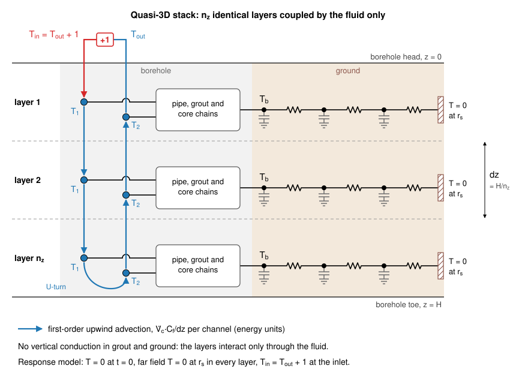

# Response model

[`trcm`](@ref) stacks ``n_z`` layers of thickness ``\Delta z = H/n_z`` along the borehole
(Pasquier & Marcotte, 2014). Without a buried depth (short term, the default), only the fluid
channels are coupled between layers; the vertical conduction in the grout and the ground is
neglected. With a buried depth `D`, the ground also conducts heat vertically (see
[Vertical conduction in the ground](@ref)).



## Vertical resistances

The quasi-3D network of Pasquier & Marcotte (2014, Fig. 3 and Table 1) has two kinds of vertical
links:

- the **fluid** resistance ``\tilde R_f = 1/(\dot m c_f)`` between the fluid nodes of consecutive
  layers, i.e. the advection of the heat carrier fluid, included here as an upwind energy flux;
- a short **soil column below the toe** (`nzs` nodes of radius ``8 r_b`` linked by
  ``\tilde R_s = \Delta z/(k_s A)``), the only vertical conduction of their model. Every other vertical
  resistance (pipe, grout, casing, soil along the borehole) is infinite in their Table 1.

The soil column below the toe is not included in the short-term model: it only matters once heat
has diffused below the toe, i.e. at times when the far-field boundary and the missing vertical
conduction along the borehole matter as well, and which `outlet_transfer_function` of
GroundHeatExchanger.jl hands over to the finite line source (see [Short and long term](@ref)).
With a buried depth `D`, [`trcm`](@ref) has the complete vertical conduction of the ground,
including the soil below the toe and the ground surface.

## Advection

Each channel ``c`` carries the flow rate ``\dot V_c`` downwards or upwards. The fluid node of layer
``k`` exchanges with its upstream neighbour (first-order upwind)

```math
C_{f,k}\frac{dT_{f,k}}{dt} = \cdots + \frac{\dot V_c C_f}{\Delta z}\left(T_{f,\text{up}} - T_{f,k}\right),
```

where ``C_{f,k}`` is the capacity of the node (the fluid plus the half pipe shell it holds). The
advection is assembled in energy units, together with the conduction, before dividing by the
capacities, so the energy balance is exact: at steady state, the heat crossing the borehole wall
equals ``\dot V C_f (T_\text{in} - T_\text{out})`` (tested to ``10^{-8}``). The first-order upwind
scheme adds some numerical dispersion to the fluid front, reduced by increasing `nz`.

The up-going channels are fed at the toe by their down-going pair (U-turn of each U-tube; bottom
of the annulus or of the center pipe of a coaxial exchanger or a standing column well).

## Boundary conditions and transfer functions

The response model imposes (Pasquier & Marcotte, 2014, Eqs. 13-16):

- ``T(t = 0) = 0`` everywhere;
- ``T = 0`` at the far-field radius ``r_s`` of every layer (and, with a buried depth, at the ground
  surface and the bottom of the domain);
- ``T_\text{in}(t) = T_\text{out}(t) + \alpha`` at the borehole head, ``T_\text{out}`` being the
  flow-weighted mean of the up-going channels at the head.

The last condition is applied as the upstream temperature of the down-going channels of the first
layer, which keeps the system linear and free of penalty resistances. Since the system is linear,
``\alpha = 1`` and every temperature is directly a transfer function ``g_j = S_j/\alpha`` (Eq. 18):
``g_\text{in} = g_\text{out} + 1`` at all times, and ``g_\text{out}`` stays at zero until the fluid
residence time, as in Fig. 5 of the paper.

Because ``T_\text{in} - T_\text{out} = \alpha`` is constant, the heat injection rate
``\dot V C_f \alpha`` is constant from ``t = 0``: the response model is the response to a step of
heat injection, and the outlet temperature for any load follows by convolution (Eqs. 19-22).

## Vertical conduction in the ground

Without vertical conduction, the model behaves like a stack of infinite cylindrical sources held
at 0 at ``r_s = 20`` m: it is valid from seconds to a few months and levels off once the far field
is felt. With a buried depth `D`, [`trcm`](@ref) builds a TRCM column instead, the emitter of
[`trcm_pairs`](@ref) (see [Borehole-to-borehole responses](@ref)):

- the layers have the same radial soil nodes, and the ground conducts heat vertically between the
  soil nodes of the same radius (conductance ``k_s A_i / \Delta z``);
- soil-only layers cover the buried depth ``D`` above the borehole head, and ``n_\text{below}``
  layers, geometrically thicker, extend down to a depth ``r_s`` below the toe;
- the ground surface, the bottom of the domain and the far-field radius are held at 0, with
  ``r_s = 300`` m and ``n_s = 100`` soil shells by default ([`TRCMSettings`](@ref));
- the vertical conduction inside the borehole (fluid, pipes, grout) is neglected.

The response is then valid from seconds to decades, for every exchanger type, at a higher cost
(2D columns, radius × depth): about 2 s instead of 0.1 s for a single U-tube of 150 m (see
[With or without vertical conduction](@ref)). The layers have different
thicknesses, so the system is assembled in W/K and J/K before dividing by the capacities. The
casing is not available in this mode.

## Solver

The network is a linear system of ordinary differential equations ``\dot u = M u + b`` with a
constant, very sparse matrix ``M``, whose exact Jacobian is handed to a stiff solver: `Rodas5P` with
the KLU sparse LU without vertical conduction (a few thousand nodes, about 0.1 s), `FBDF` with the
KLU sparse LU for the 2D columns. [`trcm`](@ref) returns the outlet transfer function
``g_\text{out}``; the inlet transfer function is ``g_\text{out} + 1``.
